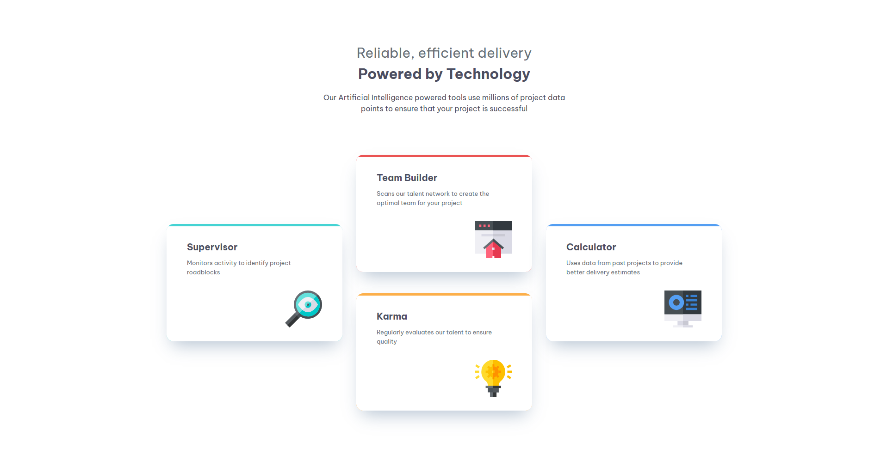
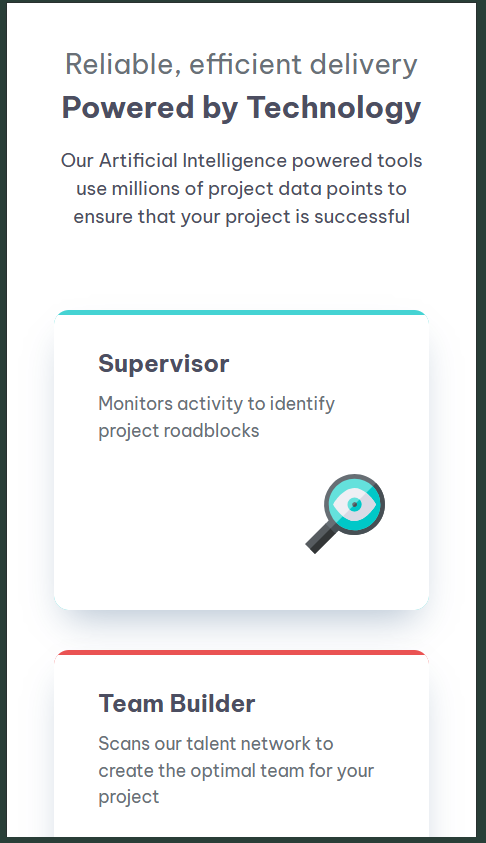

# Frontend Mentor - Four Card Feature Section

This is my solution to the Four Card Feature Section on Frontend Mentor.

## Overview

### The Challenge

Build a responsive four-card feature section that adapts to different screen sizes.

### Screenshot

### Links

- [Live Site URL](https://98dinesh89.github.io/Frontend-Mentor-Four-card-feature-section/)

## My Process

### Built With

- HTML5
- CSS3
- CSS Grid
- Flexbox
- CSS custom properties
- Responsive design with media queries

### What I Learned

- Creating layouts using CSS Grid and Flexbox.
- Using CSS custom properties for colors and font sizes.
- Making layouts responsive for desktop and mobile screens.
- Styling cards with borders, rounded corners, and box shadows.

## Author

- [My Frontend-Mentor Profile](https://www.frontendmentor.io/profile/98Dinesh89)
